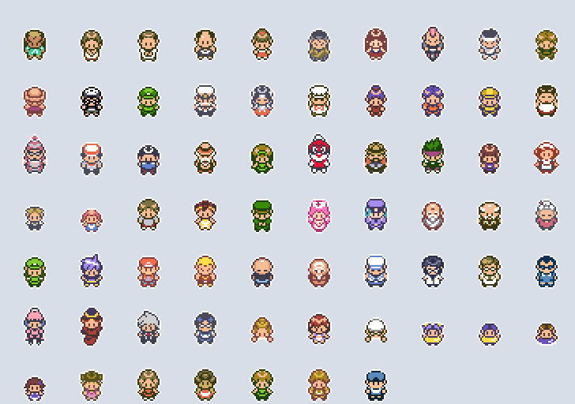

## Gen_2.5_sprites
- Asset type: Overworld trainer & NPC sprites (67 sprites, 16x32 GBA format 3 of them are 32x32)
- Edited by: Dieb-0
- Original creator(s): Original base sprites were a mix of mostly vanilla frlg sprites and some by the artists Cesare_CBass, AveonTrainer, PurpleZaffre, and BatimaTheBat. 
- Notes: It is difficult to ascertain exactly who did which sprite at this stage, so just to be safe please credit the above mentioned artists if you want to use these. This is supposed to be a sprite recoloring of gen 3 overworld sprites to match the "vibe" of gbc sprites. The limitations aren't exactly followed as:
1.gen 3 sprites are longer in height
2.for certain sprites reducing them to only 4 colors makes them look very unpleasant, so i took creative liberties. They mostly fall under 4-6 palette range
3.The white outline is inspired from pokemon seaglass emerald aesthetic, and the sprites were intended for my wip romhack.
4.Looking at the preview, even I'll admit that the sprites dont look too coherent with eachother, but they look fine in isolation.

The sprites will be reworked in the future when I come back to cringe on them.
More batches coming soon.

